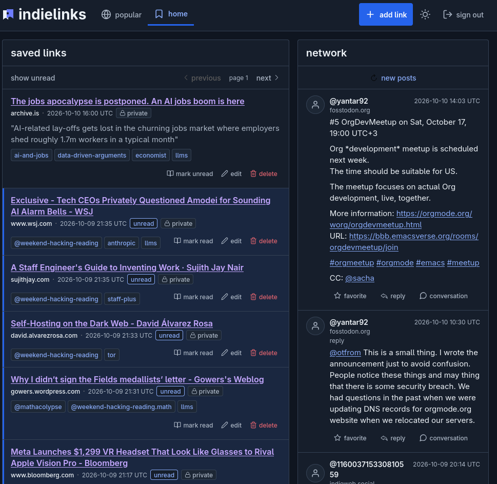
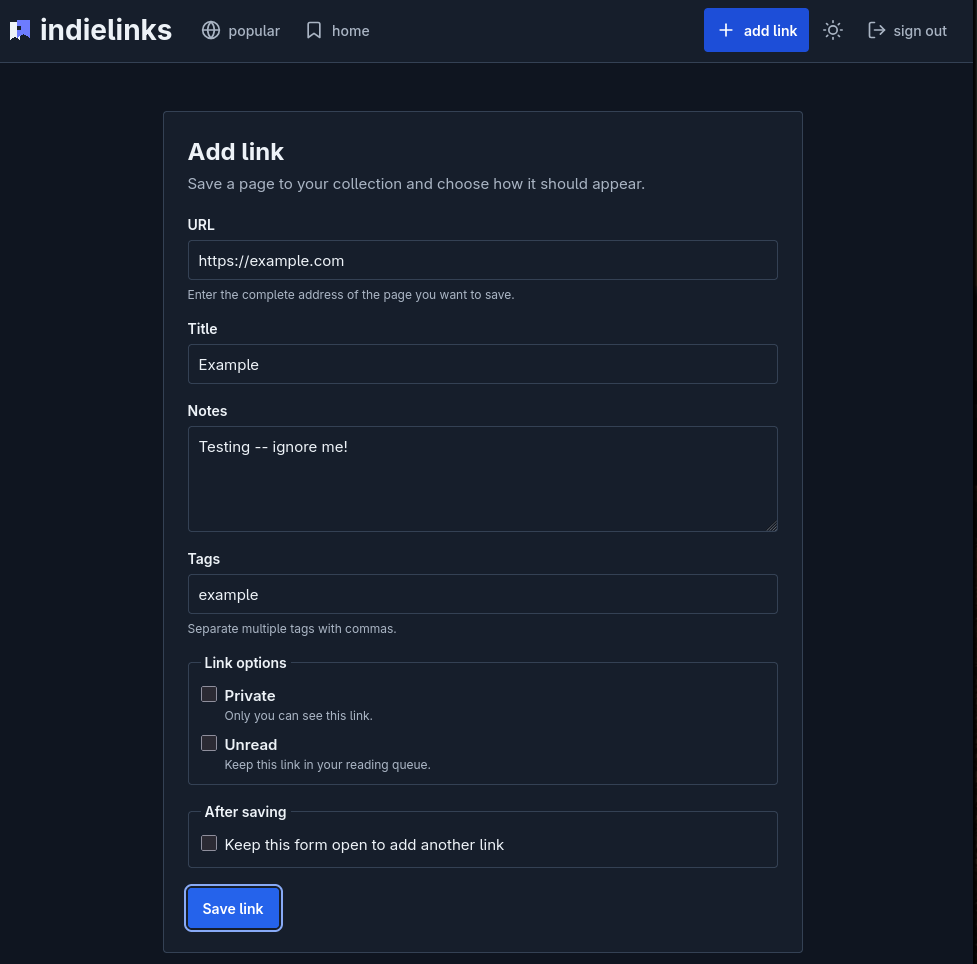
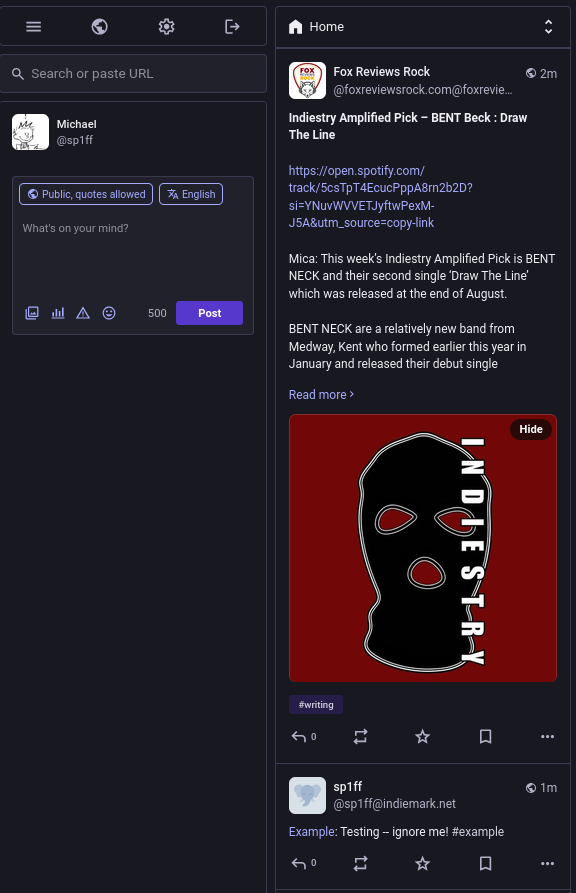
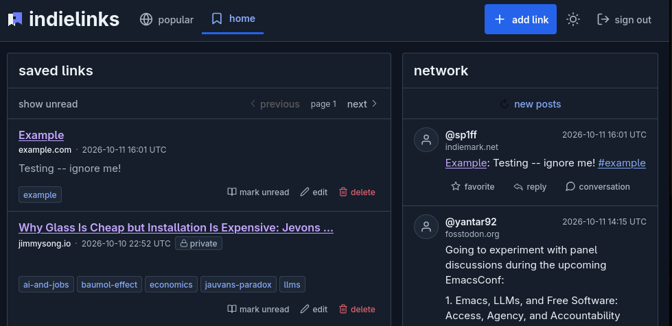

 #+TITLE: indielinks
#+DESCRIPTION: Bookmarks in the Fediverse
#+DATE: <2026-10-28 Wed 18:58>
#+AUTODATE: t
#+OPTIONS: toc:nil org-md-headline-style:setext *:t ^:nil
#+STARTUP: overview

* Introduction

[[https://web.archive.org/web/20080906021806/http://delicious.com/][del.icio.us]] on the [[https://en.wikipedia.org/wiki/Fediverse][Fediverse]]; bookmark (and tag) the web, follow people you trust, and discover content without a platform deciding what you see.

[[https://en.wikipedia.org/wiki/Delicious_(website)][Social bookmarking]] used to be a content discovery mechanism: save links, follow other people and see what they were reading. Indielinks is social bookmarking over [[https://www.w3.org/TR/activitypub/][ActivityPub]]: save & tag things here, links you make public appear in your followers' feeds--  on indielinks, [[https://joinmastodon.org/][Mastodon]], or any other app that speaks ActivityPub.

indielinks lets you manage your links:

#+ATTR_HTML: :style margin-left: auto; margin-right: auto; display: block; :width 80%
#+NAME: indielinks
#+CAPTION: My reading list

but it's federated: when you add a (public) link...

#+ATTR_HTML: :style margin-left: auto; margin-right: auto; display: block; :width 90%
#+NAME: fediverse
#+CAPTION: Adding a public link

it will show up in your followers' feeds (Mastodon, here), where they can comment, boost & re-post...

#+ATTR_HTML: :style margin-left: auto; margin-right: auto; display: block;
#+NAME: fediverse
#+CAPTION: The link showing up in my indieweb.social timeline

as well as their indielinks feeds:

#+ATTR_HTML: :style margin-left: auto; margin-right: auto; display: block;
#+NAME: fediverse
#+CAPTION: The link showing up in my indieweb.social timeline

Either way, you can like, share or discuss whatever you & your friends are reading.
* License

indielinks is released under the [[https://spdx.org/licenses/GPL-3.0-or-later.html][GPL v3.0]].
* Installation
:PROPERTIES:
:CUSTOM_ID: installation
:END:

I'm in the process of standing-up the first indielinks instance (at [[https://indiemark.sh][indiemark.sh]]; it's up intermittently at the time of this writing). In the meantime, indielinks can be installed locally, running against ScyllaDB. You can [[#pre_requisites][build]] the project from source, but I maintain an Arch package on the [[https://aur.archlinux.org/packages/indielinks-git][AUR]], and a Debian binary package here (under "Releases"). See [[INSTALL.org]] for details.
* Pre-requisites
:PROPERTIES:
:CUSTOM_ID: pre_requisites
:END:

To run indielinks locally, you'll need to have [[https://www.scylladb.com/][ScyllaDB]] installed, or Docker (to pull & run ScyllaDB images).

To build from source, the Rust stable [[https://rustup.rs/][toolchain]] is required. The integration tests require [[https://www.docker.com/][Docker]], as well as [[https://www.haproxy.org/][haproxy]]. You'll want [[https://trunkrs.dev/][trunk]] for building & working on the frontend, along with [[https://tailwindcss.com/][TailwindCSS]], and the [[https://nickel-lang.org/getting-started/][nickel]] configuration language tool. See [[file:HACKING.org][HACKING.org]] for a complete list, as well as more information on, well, on hacking on the project.
* Status & Roadmap

I've been using indielinks locally for some time, now, running it as a systemd unit on bare metal to save bookmarks, maintain reading lists, & post to the Fediverse (via a CloudFlare tunnel-- I'm [[https://indiemark.net/.well-known/webfinger?resource=acct:sp1ff@indiemark.net][sp1ff@indiemark.net]], there). I've just stood-up my first hosted instance, [[https://indiemark.sh][indiemark.sh]], on a "friends & family" basis & will be transferring my Fediverse presence there, while knocking-off bugs, adding features & so on before opening it up more generally.

You can read more about the project & goals [[https://www.unwoundstack.com/blog/indielinks.html][here]]. I presented on the project last year at the [[https://www.meetup.com/vancouver-rust/events/307731034/][Vancouver Rust Meetup]] (recording [[https://www.youtube.com/watch?v=aztJzpBRFAQ][here]]).

In the meantime, comments, suggestions and contributions are welcome, on [[https://indieweb.social/@sp1ff][Mastodon]], in the [[https://github.com/sp1ff/indielinks/issues][issues]] or at [[mailto:indielinks@pobox.com][indielinks@pobox.com]].
